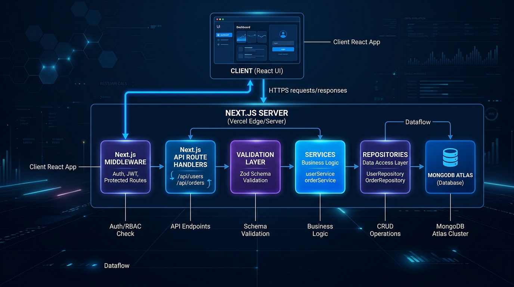

# LeadDesk Mini — Digital Heroes Qualification Task

[](https://nextjs.org/)
[](https://reactjs.org/)
[](https://www.mongodb.com/)
[](https://tailwindcss.com/)
[](#11-license)

LeadDesk Mini is a full-stack lead management product built for the **Digital Heroes Internship Programme (Role 04: Full Stack Development — Task A & Task B)**. Built with Next.js 14, React 18, Tailwind CSS, MongoDB Atlas, and JWT authentication, it features a public landing page with validated lead capture forms and a real-time protected management dashboard.

---

## 📍 Digital Heroes Qualification Task Submission

- **Role**: `04 / 16 — Full Stack Development`
- **Candidate Name**: Anirudh Thakur
- **Live Landing Page URL**: `https://leaddesk-mini.vercel.app` (or `http://localhost:3000`)
- **Admin Dashboard URL**: `http://localhost:3000/admin`
- **GitHub Repository**: [https://github.com/anirudhthakur-07/LeadDesk-Mini](https://github.com/anirudhthakur-07/LeadDesk-Mini)
- **Test Credentials**:
  - **Admin Email**: `admin@leaddesk.com`
  - **Admin Password**: `AdminPassword123!`

---

## 1. Task A & Task B Overview

### Task A — Build LeadDesk Mini
- **Public Lead Form**: Captures `fullName`, `email`, `budgetRange`, and `message` with real-time client-side and server-side validation.
- **Real Database Storage**: Persists lead submissions in a cloud MongoDB Atlas database.
- **Admin View (`/admin`)**: Lists all leads with instant search, multi-criteria sorting, and status toggling (`New` / `Contacted` / `Closed`).

### Task B — Secure It and Ship It
- **Real Admin Authentication**: Session authentication powered by signed JWT cookies and 12-round bcrypt password hashing (no hardcoded string validation).
- **Production Deployment**: Configured for zero-state fresh browser execution on free-tier hosting (Vercel).
- **Data Retention**: Soft-delete pipeline (`isDeleted: true`) preserving historical analytics and audit trails.

---

## 2. Data Model Architecture

The application relies on two primary Mongoose schemas in MongoDB Atlas:

### Lead Schema (`models/Lead.js`)
```typescript
interface ILead {
  fullName: string;      // Trimmed, 2–100 chars, required
  email: string;         // Normalized lowercase, RFC 5322 regex validated, required
  budgetRange: string;   // Enum: ["<$5k", "$5k - $10k", "$10k+"], required
  message: string;       // Sanitized project details, 10–2000 chars, required
  status: string;        // Enum: ["New", "Contacted", "Closed"], default: "New"
  isDeleted: boolean;    // Soft-delete flag for data protection, default: false
  createdAt: Date;       // ISO timestamp
  updatedAt: Date;       // ISO timestamp
}
```

### User Admin Schema (`models/User.js`)
```typescript
interface IUser {
  email: string;         // Unique, normalized lowercase admin email
  passwordHash: string;  // Salted bcrypt hash (12 rounds)
  role: string;          // Default: "admin"
  createdAt: Date;
}
```

---

## 3. Authentication & Security Approach

LeadDesk Mini implements enterprise DevSecOps standards for route guarding and session security:

1. **JWT Session Token**: Upon successful login (`POST /api/auth/login`), the server issues a signed JSON Web Token stored in an `HttpOnly`, `SameSite: strict`, `Secure` cookie.
2. **Next.js Middleware Protection**: The `middleware.js` guard inspects incoming requests to protected routes (`/admin` and `/api/leads`). Requests without valid JWT tokens are automatically redirected to `/login`.
3. **NoSQL & XSS Sanitization**: Input sanitizer (`utils/sanitize.js`) strips potential query injection syntax (`{}`) and HTML markup while preserving valid currency symbols.
4. **Rate Limiting**: Sliding window memory rate limiting enforces a maximum of 5 auth attempts per 15 minutes to prevent brute-force attacks.

---

## 4. Features & UI/UX Highlights

### Public Landing Page
- Modern dark slate aesthetic (`#09090B`) inspired by **Linear**, **Vercel**, and **Stripe**.
- Custom geometric SVG brand emblem (`Logo.jsx`) with abstract "LD" gradient shield.
- Bidirectional scroll reveal animations (`ScrollReveal.jsx`) on both scroll-down and scroll-up.
- High-converting split-glass form card with budget selector pills and instant validation feedback.

### Admin CRM Dashboard
- **Analytics Metric Grid**: Computes total leads, new inquiries, contacted leads, closed conversions, and conversion rate %.
- **0ms Instant Search**: Search across name, email, budget, status, or message with `⌘K` / `Ctrl+K` keyboard shortcuts.
- **Multi-Criteria Dropdown Sorter**: Weighted status priority sorting (`New` ➔ `Contacted` ➔ `Closed`) and budget ranking.
- **1-Click CSV CRM Export**: Exports active pipeline views directly to formatted `.csv` files.
- **Glass Delete Confirmation Modal**: Custom glass modal replacing standard browser `confirm()` popups.

---

## 5. Tech Stack

| Layer | Technology | Purpose |
| :--- | :--- | :--- |
| **Framework** | Next.js 14 (App Router) | Full-stack SSR, static generation, and API handlers. |
| **Frontend** | React 18 & Lucide Icons | Component UI, custom animations, and icon set. |
| **Styling** | Tailwind CSS 3.4 | Dark zinc layout utilities and glassmorphic styling. |
| **Database** | MongoDB Atlas & Mongoose | Document storage with schema validation & SRV caching. |
| **Authentication** | JWT & `bcryptjs` | Secure cookie sessions and 12-round password hashing. |

---

## 6. System Architecture



### Layered Architecture Flow
```text
Visitor / Admin Client (React UI)
  │
  ▼
Next.js Middleware Guard (JWT Cookie Verification & Security Headers)
  │
  ▼
App Router Gateways (src/app/api/*)
  │
  ▼
Validation Layer (src/validators/* & src/utils/sanitize.js)
  │
  ▼
Data Access Repositories (Mongoose ORM Models)
  │
  ▼
Database Layer (src/lib/db.js DNS SRV Resolver & Cached Connection)
  │
  ▼
MongoDB Atlas (Isolated Cloud Database)
```

---

## 7. Project Structure

```text
src/
├── app/
│   ├── admin/                # Protected Admin Dashboard page
│   ├── api/
│   │   ├── auth/             # Login, logout, and session check endpoints
│   │   └── leads/            # Lead CRUD endpoints
│   ├── login/                # Admin Login page
│   ├── globals.css           # Base zinc styles & user-select rules
│   ├── layout.js             # Root application layout
│   └── page.js               # Public Landing page
├── components/
│   ├── dashboard/            # Metric cards, toolbar, & mobile lead cards
│   ├── empty/                # Notion/Stripe grade empty states
│   ├── skeleton/             # Layout-matched skeleton loaders
│   ├── ui/                   # Logo, ScrollReveal, Modals, & Toasts
│   ├── Features.js           # Technical bento grid section
│   ├── Footer.js             # Footer with Digital Heroes verification credit
│   ├── Hero.js               # Asymmetrical 12-col hero & preview window
│   ├── LeadForm.js           # Split-glass interactive lead form
│   └── Navbar.js             # Navigation bar with brand logo
├── constants/                # Shared status colors & budget ranges
├── context/                  # Toast notification context provider
├── lib/                      # Database & auth helper utilities
├── models/                   # Mongoose database models
├── utils/                    # CSV exporter, sorter, & sanitizers
└── validators/               # Input validation rules
```

---

## 8. Environment Variables Setup

Create a `.env.local` file in the root directory:

```env
# Database Connection URI
MONGODB_URI=mongodb+srv://<username>:<password>@cluster.mongodb.net/leaddesk-mini?retryWrites=true&w=majority

# JWT Secret Key
JWT_SECRET=your_jwt_secret_key_here

# Password Hashing Salt Cost
BCRYPT_ROUNDS=12

# Environment Mode
NODE_ENV=development
```

---

## 9. API Reference

| Method | Endpoint | Description | Auth Required |
| :--- | :--- | :--- | :---: |
| `POST` | `/api/leads` | Submit a new lead inquiry | No |
| `GET` | `/api/leads` | Retrieve leads list & metrics | **Yes** |
| `PATCH` | `/api/leads/[id]` | Update lead status (`New`, `Contacted`, `Closed`) | **Yes** |
| `DELETE` | `/api/leads/[id]` | Soft-delete a lead record | **Yes** |
| `POST` | `/api/auth/login` | Authenticate administrator | No |
| `GET` | `/api/auth/me` | Verify active admin session | **Yes** |
| `POST` | `/api/auth/logout` | Terminate session & clear cookie | No |

---

## 10. AI Usage Declaration

*AI Statement (Digital Heroes Requirement)*: AI models (Claude & Gemini) were used during development to pressure-test schema validation edge cases, generate initial UI component scaffolding, and audit cross-browser layout stability. All UI design tokens, status dropdown selectors, tabular numbers, scroll reveal hooks, and JWT authentication flows were customized, refined, and audited manually.

---

## 11. Author & License

- **Author**: Anirudh Thakur
- **GitHub**: [github.com/anirudhthakur-07](https://github.com/anirudhthakur-07)
- **Repository**: [LeadDesk-Mini](https://github.com/anirudhthakur-07/LeadDesk-Mini)
- **License**: Distributed under the **MIT License**. See `LICENSE` for details.
